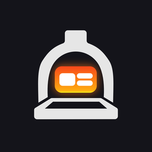

<h1 align="center">Kiln</h1>

<b>Draw your Roblox UI in Affinity. Get it in Studio as real instances.</b>

<!-- TODO(owner): hero screenshot or GIF, e.g. assets/readme-hero.gif -->

<i>Screenshot / GIF coming soon</i>

## What Kiln does

- **Affinity layers become native Roblox UI.** Frames, TextLabels and ImageButtons with UICorner, UIStroke and
  UIGradient where the design calls for them, not a flat screenshot.
- **Live canvas.** Your screen shows up in Kiln next to the Roblox tree it will become, and edits go straight back
  to Affinity.
- **Animate tab.** Give layers entry, exit and hover animations, preview them in Kiln, and they play the same way
  in your game.

<!-- TODO(owner): a short GIF of the animate tab, e.g. assets/readme-animate.gif -->

## Early Access

<!-- TODO(owner): the public Polar checkout URL -->

<a href="https://polar.sh/TODO-checkout-url"><b>➜ Request Early Access, $15/mo</b></a>

| Plan | New imports per day | Price |
|---|---|---|
| Free | 10 | Free, no key needed |
| Pro | 25 | $15/mo, $100/yr, or $250 lifetime |
| Founding (early supporters) | 50, plus beta features | Pro prices, 50% off your first 3 months |

<!-- TODO(owner): the Founding checkout URL -->
Founding is for early supporters: [join as a Founding supporter](https://polar.sh/TODO-founding-checkout-url).
The discount covers your first 3 monthly payments ($7.50 each), or your whole first payment on yearly ($50) or
lifetime ($125). Its beta features are the Animate Timeline and the State Graph Editor as they land.

**What counts as an import?** One import is one unique screen: a GUI that opens on its own, like a Shop, an
Inventory or a Settings menu. Syncing a screen you've already imported is always free, however much you change it.
A new frame is a new import, so adding a Rebirth screen next to your Shop counts once. Grouping several screens
together still counts each of them, while a HUD made of pieces pinned around the screen counts as one. Kiln shows
what it found before anything counts.

## Install

1. Download the latest `Kiln-<version>.zip` from [Releases](https://github.com/rblx-keii/Kiln-Releases/releases/latest).
2. Unzip it anywhere you can write to, for example `Documents\Kiln`. It's portable: no installer.
3. Run `Kiln.exe`. If Windows says "Windows protected your PC", click **More info**, then **Run anyway**. This
   early version isn't code-signed yet.
4. Follow the Setup checklist. It links Kiln to Affinity and Roblox Studio.

More detail: [Get started](https://rblx-keii.github.io/Kiln-Releases/start.html).

## Activate

After you buy, Polar emails you a license key. In Kiln, open **Settings > License**, paste the key and click
**Activate**. A key works on one computer at a time: to move it, click **Deactivate** on the old computer first
(or free it in the customer portal). Without a key Kiln runs on the Free plan. The [after-checkout page](https://rblx-keii.github.io/Kiln-Releases/docs/success.html)
walks through it step by step.

## Requirements

- Windows 10 or 11
- Affinity 3.3 (the version Kiln is tested with), with its MCP server turned on
- Roblox Studio, with the [Kiln plugin](https://create.roblox.com/store/asset/111742931087316)

## Known limitations

- Windows only.
- Some Affinity effects become images rather than native Roblox instances.
- Kiln isn't code-signed yet, so Windows SmartScreen warns on first run.
- Counting the screens in a document is new and may get edge cases wrong. If a count looks off, tell us
  (Help > Copy Diagnostics includes how Kiln counted, without your layer names).

## Early Access

Kiln is in Early Access. Expect rough edges and changes between versions; keep backups of your Affinity
documents.

## Refunds

<!-- TODO(owner): refund wording -->
TODO: refund policy.

## Support

<!-- TODO(owner): Discord invite and issues link -->
- Discord: TODO
- Bug reports: TODO (GitHub issues link)
- Email: official.keii@outlook.com

In Kiln, **Help > Copy Diagnostics** copies what a bug report needs, with your keys taken out.

## Legal

[Privacy](https://rblx-keii.github.io/Kiln-Releases/privacy.html) ·
[Terms](https://rblx-keii.github.io/Kiln-Releases/terms.html) ·
<!-- TODO(owner): link THIRD_PARTY_NOTICES once it's published -->
Third-party notices: TODO (THIRD_PARTY_NOTICES)

Kiln is independent and not affiliated with Canva, Affinity, Serif or Roblox.
